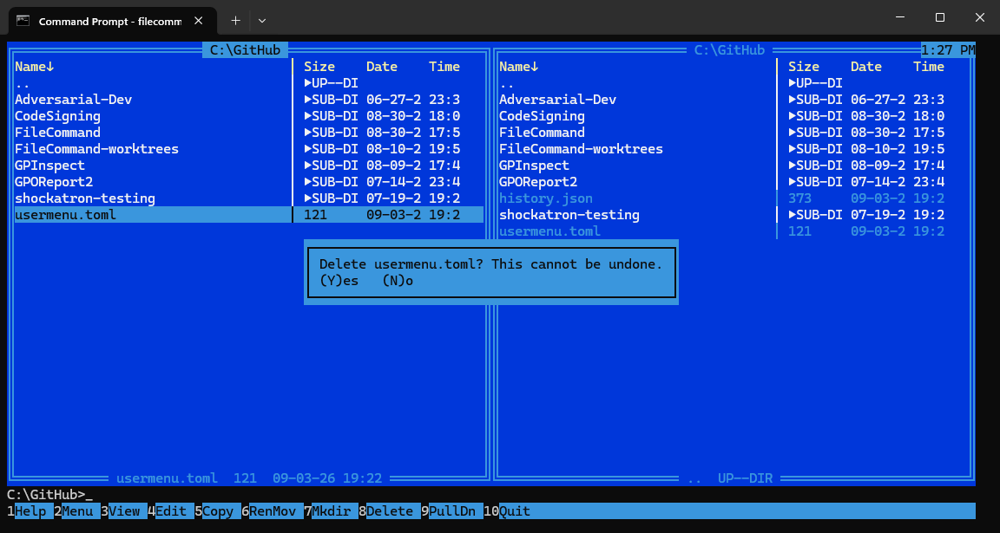
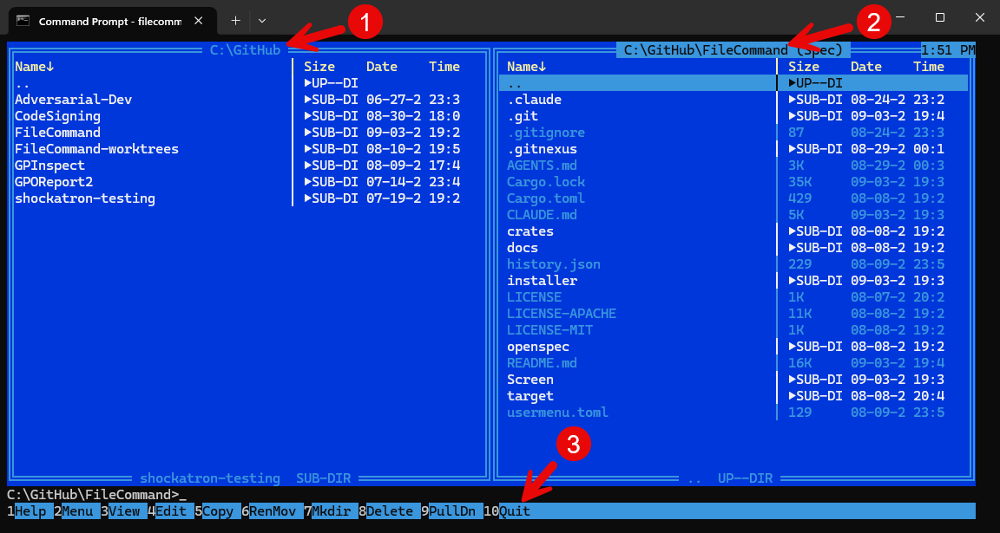

# FileCommand

A keyboard-driven, dual-panel file manager for the terminal, written in Rust
([ratatui](https://github.com/ratatui/ratatui) + [crossterm](https://github.com/crossterm-rs/crossterm)).
It recreates the look, layout, and workflow of Norton Commander 5.5 (1998) —
blue/cyan panels, double-line frames, a function-key command bar, and an
always-available command line — with a small set of modern extras layered on
top: quick filter, fuzzy directory jump, panel tabs, git-aware panel info,
mouse support, and switchable themes.

**Platform:** Windows-first (Windows Terminal / PowerShell console / `conhost`).
The codebase stays cross-platform via `crossterm`, but only Windows is tested
and supported.



## Contents

- [Installing](#installing)
- [Building from source](#building-from-source)
- [Command-line options](#command-line-options)
- [Configuration](#configuration)
- [Using FileCommand](#using-filecommand)
  - [Screen layout](#screen-layout)
  - [Command line](#command-line)
  - [Keyboard reference](#keyboard-reference)
  - [Mouse reference](#mouse-reference)
  - [Pull-down menus (F9)](#pull-down-menus-f9)
  - [Panel display modes](#panel-display-modes)
  - [File operations](#file-operations)
  - [Viewer (F3) and editor (F4)](#viewer-f3-and-editor-f4)
  - [Themes](#themes)
- [Diagnostics](#diagnostics)
- [Project layout](#project-layout)
- [Testing](#testing)
- [Contributing](#contributing)
- [Reporting issues](#reporting-issues)
- [License](#license)

## Installing

The easiest way to get FileCommand on Windows is the bundled installer:

1. Build (or download) `FileCommandSetup.exe` — see
   [`installer/README.md`](installer/README.md) for build instructions,
   prerequisites (Rust, .NET SDK, WiX v4/v5 CLI), and a winget manifest.
2. Run it. By default it installs **per-user, with no elevation**, to
   `%LocalAppData%\Programs\BigHatGroup\FileCommand`, adds itself to your
   user `PATH`, and creates a Start Menu shortcut.
3. Open a **new** terminal window (existing ones won't see the updated
   `PATH`) and run:

   ```powershell
   filecommand
   ```

For an elevated, machine-wide install instead:

```powershell
FileCommandSetup.exe /quiet InstallScope=perMachine
```

Silent uninstall:

```powershell
FileCommandSetup.exe /uninstall /quiet
```

See [`installer/README.md`](installer/README.md) for the full scope
semantics (per-user vs. per-machine, upgrade behavior, production code
signing) and the winget package template.

## Building from source

Requires the [Rust toolchain](https://rustup.rs) (stable).

```powershell
git clone https://github.com/kkaminsk/FileCommand.git
cd FileCommand
cargo build --release
```

The binary is produced at `target\release\filecommand.exe`. Run it directly,
or via Cargo:

```powershell
cargo run --release
```

The workspace has two crates:

- `filecommand-core` — state, the reducer (`core::update`), file operations,
  listing/sorting/filtering, git info, config/theme loading. No terminal
  dependencies; fully unit-testable.
- `filecommand-tui` — the `filecommand` binary: the event loop, rendering,
  input mapping, and terminal ownership.

## Command-line options

| Flag | Effect |
|---|---|
| `--theme <name>` or `--theme=<name>` | Launch with a specific theme for this session, overriding the saved `theme =` in `config.toml`. Built-in names: `nc-classic`, `nc-mono`, `terminal-green`, `purple-lights`, `yellow-storm`, `inverted`. |
| `--nosplash` | Skip the startup splash screen, overriding `splash = true` in `config.toml`. |
| `--nomouse` | Disable mouse capture for this session, overriding `[mouse] enabled` in `config.toml`. |
| `--noanimations` | Disable the decorative UI animations (splash entrance, menu and dialog openings, panel reveal) for this session, overriding `animations = true` in `config.toml`. |
| `--config-dir <path>` or `--config-dir=<path>` | Use `<path>` as the profile directory holding `config.toml`, `history.json`, and `usermenu.toml` for this session, overriding portable mode and the platform default (see [Configuration](#configuration)). |
| `--log <path>` or `--log=<path>` | Append diagnostic messages to `<path>` for this session (see [Diagnostics](#diagnostics)). Overrides the `FILECOMMAND_LOG` environment variable. |

Flags can be combined in any order, e.g. `filecommand --nosplash --theme=purple-lights`.

## Configuration

FileCommand reads and writes all of its files in one **profile directory**,
resolved once at startup in this order:

1. `--config-dir <path>` — an explicit override for testing and scripting
   (a relative path resolves against the launch directory).
2. **Portable mode** — when a file named `portable` exists next to the
   executable, the executable's own directory is the profile directory.
3. The platform default — `%APPDATA%\FileCommand` on Windows,
   `$XDG_CONFIG_HOME/filecommand` (falling back to
   `~/.config/filecommand`) elsewhere. `--help` prints the resolved
   default.

The directory is created on first run. If it can't be created, the session
runs on in-memory defaults with saving turned off, and a startup warning
names the path and the error. Because `history.json` lives in one place,
command history and the Ctrl+J fuzzy-jump frecency list are shared no
matter which directory FileCommand is launched from.

**Coming from a per-directory layout?** Earlier versions read and wrote
these files in the launch directory. FileCommand never moves or deletes
the old files: when the profile directory has no `config.toml` yet and the
launch directory still holds any of the three, a startup notice says where
FileCommand now reads from so you can move them yourself.

Missing files are created with defaults on first run; a malformed file
produces a startup warning and falls back to defaults rather than being
silently overwritten.

### `config.toml`

Flat `key = value` lines (not a full TOML parser, aside from the `[mouse]`
table below), one setting per line:

```toml
splash = true
animations = true
theme = "nc-classic"
shell = "cmd.exe /C"
editor = "code -w"
panel_split = 50

[mouse]
enabled = true

key.paste_name = "ctrl+enter"
key.paste_path = "ctrl+]"
key.quick_filter = "ctrl+p"
key.fuzzy_jump = "ctrl+j"
key.split_left = "ctrl+left"
key.split_right = "ctrl+right"
key.split_reset = "ctrl+="
key.clipboard_files = "ctrl+c"
key.clipboard_paths = "ctrl+shift+insert"
key.clear_line = "ctrl+y"
```

| Key | Meaning | Default |
|---|---|---|
| `splash` | Show the startup splash screen. | `true` |
| `animations` | Run the decorative ASCII animations: the splash entrance, the F9 bar sweep, pop-up menus unfolding, dialogs opening, and the panel reveal after the splash. `false` shows every surface in its final form immediately. Loading feedback (directory listings, progress counters) is never animated. | `true` |
| `theme` | Active theme name (one of the six built-ins — see [Themes](#themes)). | `nc-classic` |
| `shell` | Shell command line used by the file-action menu's Run entry and the F2 user menu. | `cmd.exe /C` on Windows, `/bin/sh -c` elsewhere |
| `editor` | External editor command for F4; unset means "use the built-in editor". | unset |
| `panel_split` | Left-panel width as a percentage. | `50` |
| `[mouse] enabled` | Whether mouse capture is enabled at all. | `true` |
| `key.*` | Overridable key bindings (see table below). | see below |

Only the bindings listed above are configurable; the rest of the key map
(F-keys, Tab, arrows, Ctrl+T/W, etc.) is fixed. Unknown keys are ignored
rather than rejected, and the schema tolerates missing/malformed lines.

### `usermenu.toml`

F2 user-menu entries — a real TOML array of tables:

```toml
[[entry]]
label = "Open command prompt here"
command = "cmd.exe"

[[entry]]
label = "Directory listing"
command = "dir"
```

Unlike `config.toml`, a malformed `usermenu.toml` is treated as an error: it
falls back to a default menu and shows a warning rather than being silently
overwritten.

### `history.json`

Command-line history and fuzzy-jump directory frecency data, written
atomically so a crash mid-write never corrupts it. Not meant to be hand-edited.

## Using FileCommand

### Screen layout



1. **Left navigation pane** — its own directory, cursor, selection, sort
   mode, filter, and display mode; the path renders inverse in the top
   border when this panel is active.
2. **Right navigation pane** — independent of the left: its own mode, sort,
   filter, and tabs, so the two panels can browse entirely different
   locations at once.
3. **F-key menu** — the function-key command bar (`1Help 2Menu 3View 4Edit
   5Copy 6RenMov 7Mkdir 8Delete 9PullDn 10Quit`); clickable with the mouse,
   and relabels under Ctrl/Alt for their key-bar variants.

- Two independent panels, each with its own directory, cursor, selection,
  sort mode, filter, and display mode.
- **Tab** switches which panel is active (the active panel's path renders
  inverse in its top border).
- **The command line** sits below the panels and always shows the active
  panel's path as its prompt. It understands three built-in verbs (`cd`,
  `del`, `rmdir`) and nothing else — see [Command line](#command-line).
- Terminal is usable down to a minimum size; below that, panels are replaced
  with a "terminal too small" placeholder and the F-key bar degrades through
  progressively shorter forms as width shrinks.
- The startup splash (product name/version banner) is the very first frame
  unless `--nosplash`/`splash = false`; any key dismisses it early. Its box
  traces in and its lines reveal within the 800 ms hold; turn that and the
  menu/dialog motion off with `--noanimations`/`animations = false`.

### Command line

The line just above the F-key bar is an NC-style command line. Its prompt is
the active panel's current directory (e.g. `C:\Projects\app>`), and it
follows the active panel: press Tab or change directory and the prompt
updates.

The command line is a quick way to navigate and to delete a single item by
name. **It is not a shell**: it never passes text to `cmd.exe`/PowerShell,
and anything other than the three built-in verbs below is rejected. To run
programs, see [Running programs](#running-programs).

#### Typing

You don't need to focus the command line. While the panels have the
keyboard (no dialog, menu, type-ahead jump, or Ctrl+P quick filter open),
every plain printable key is inserted into the command line at the caret
and the panel cursor stays put. The caret moves with ←/→ while the line
has text, so fixing one character in the middle of a command never means
retyping its tail.

Some keys mean different things depending on whether the line is empty:

| Key | Line empty | Line has text |
|---|---|---|
| Printable character | Starts the line | Inserted at the caret |
| `+` / `-` / `*` | Select / deselect by wildcard, invert selection | Typed as text |
| Backspace | Go to the parent directory | Delete the character before the caret |
| ← / → | Nothing | Move the caret |
| Ctrl+Backspace | Go to the parent directory | Delete the word before the caret |
| ↑ / ↓ | Move the panel cursor | Recall older / newer history |
| Enter | Act on the cursor entry (open a directory, file-action menu for a file) | Run the line |
| Ctrl+Enter / Ctrl+] | Paste the cursor entry's name / full path | Same, after a separating space; caret lands at the end |
| Ctrl+V | Paste the clipboard's text at the caret | Same (line breaks become spaces) |
| Ctrl+Y | Nothing | Clear the line (ends any history recall) |
| Esc | Ask to quit | Ask to quit (cancelling keeps your text) |

All other keys keep their panel meaning while you type. Home/End and
PgUp/PgDn move the panel cursor even mid-composition, Ctrl+←/→ adjust the
panel split, and Tab switches panels without clearing the line. **Delete
opens the delete confirmation for the cursor entry; it does not delete a
character.** To clear the line, press Ctrl+Y (rebindable via
`key.clear_line` in [`config.toml`](#configtoml)), or backspace it until
it's empty.

The same editing keys work in every text field — the F5/F6/F7 destination
and name fields, the file-action menu's Rename, an overwrite-conflict's
Rename, the Alt+F7 find pattern, and the Ctrl+J fuzzy-jump pattern. There
Home/End and Delete *are* editing keys (jump the caret to the start/end,
delete the character after it), Ctrl+←/→ move the caret by words,
Ctrl+Backspace/Ctrl+Delete delete words, and both Shift+Ins and Ctrl+V
paste the clipboard's text at the caret.

#### Built-in commands

| Command | What it does |
|---|---|
| `cd <path>` | Navigates the active panel to `<path>`. If the target doesn't exist or isn't a directory, the command is rejected and the panel stays where it is. |
| `del <file>` | Opens the normal F8 delete confirmation for that one file. Rejected if the target is a directory. |
| `rmdir <dir>` | Opens the normal F8 delete confirmation for that one directory, including the second confirmation if it isn't empty. Rejected if the target is a file. |

Rules that apply to all three:

- **Verbs ignore case.** `CD`, `Cd`, and `cd` are the same command.
- **Everything after the verb is one argument**, so a name with spaces
  doesn't need quotes. Surrounding double quotes are removed, so
  `cd Program Files` and `cd "Program Files"` both work.
- **Paths resolve against the active panel's directory.** These forms are
  accepted:

  | Form | Example | Resolves to |
  |---|---|---|
  | Relative | `cd src\core`, `cd ..\other` | Below or beside the current directory |
  | Current / parent | `cd .`, `cd ..` | Current directory / its parent (`cd ..` at a drive root is rejected) |
  | Drive-rooted | `cd \Temp` | `\Temp` on the current drive |
  | Absolute | `cd C:\Windows\System32` | That exact path |
  | Bare drive letter | `cd D:` | The **root** of `D:` (cmd would use D:'s last directory) |
  | UNC | `cd \\server\share\dir` | The network path (this is how you enter a UNC location by hand) |

- **One target, no wildcards.** `del *.tmp` looks for a file literally
  named `*.tmp`. To delete several items, select them with Ins or `+`
  (select by wildcard), then press F8.
- **`del`/`rmdir` never delete on their own.** They only open the same
  confirmation dialog as F8, and nothing is removed until you accept it.
  Deletes are permanent (there's no recycle bin). `.` and `..` are always
  rejected as targets, so the dialog can never offer to delete the panel's
  own directory or its parent.
- **A verb needs an argument.** A bare `cd` (no "print current directory"
  form) is rejected as unrecognized.

#### Errors

Pressing Enter always clears the line. A rejected command shows its reason
in the active panel's bottom-border status line, where it stays until the
panel next lists a directory successfully:

| Message | Cause |
|---|---|
| `'dir' is not a recognized command` | Anything other than `cd` / `del` / `rmdir` with an argument |
| `C:\Projects\nosuch not found` | The target doesn't exist |
| `C:\Projects\readme.txt is not a directory` | `cd` or `rmdir` on a file |
| `C:\Projects\docs is a directory` | `del` on a directory |
| `rmdir: invalid target ..` | `.` or `..` given to `del` / `rmdir` |

#### History

Each `cd` that succeeds is saved to the command history in `history.json`,
which keeps the most recent 200 entries. Running a command that's already
saved moves it to the newest position. Rejected lines and `del`/`rmdir`
aren't saved.

Up/Down only recall history while the line has text (on an empty line they
move the panel cursor). To browse history from an empty line, type a space
and press ↑:

- Each ↑ steps to an older entry, and each ↓ steps to a newer one.
- A recalled entry replaces the whole line. History isn't filtered by what
  you've typed.
- Pressing ↓ past the newest entry stops recalling and leaves the text as it
  is.
- Press Enter to run the recalled entry, or Backspace to edit it.

#### Pasting names and paths

To fill in a command from the panel instead of typing names:

- **Ctrl+Enter** adds the cursor entry's file name to the end of the line.
- **Ctrl+]** adds the cursor entry's full path.

If the line doesn't already end in a space, one is added first. For example,
to delete the file under the cursor in the *other* panel's directory:

1. Type `del`.
2. Press Tab, then Ctrl+] to paste the file's full path.
3. Press Enter.

Ctrl+] works in every terminal. Ctrl+Enter works on Windows, and elsewhere
only when the terminal supports the kitty keyboard protocol. You can rebind
both with `key.paste_name` and `key.paste_path` in
[`config.toml`](#configtoml).

#### Running programs

The command line can't run programs, so `dir`, `notepad notes.txt`, and
`git status` are all rejected. There are three ways to launch something:

- **Open.** Press Enter on a file and choose **Open** — the first,
  highlighted entry for a non-executable (so Enter, Enter opens a
  document), second under **Run** for an executable; on a directory
  (right-click menu) Open shows the directory in the system file browser.
  Open launches the target through the platform's file association
  (`ShellExecute` with the `open` verb on Windows, `xdg-open`/`open`
  elsewhere) **without suspending FileCommand and without waiting** — a GUI
  program simply appears beside the terminal, and a launch failure (no
  association for the extension, a missing target) is reported on the
  panel's status line.
- **The file-action menu's Run.** Press Enter (or right-click) on an
  executable (any `PATHEXT` extension, or a `.lnk`) and choose **Run** —
  the first entry for executables. Enter never starts an executable
  directly.
- **The F2 user menu.** Add an entry to [`usermenu.toml`](#usermenutoml):

  ```toml
  [[entry]]
  label = "git status"
  command = "git status"
  ```

  The command string goes to the configured `shell` exactly as written,
  with no placeholder substitution.

Run and the user menu suspend FileCommand's screen and run the command in
the active panel's directory using the `shell` from `config.toml`
(`cmd.exe /C` by default; PowerShell adds about 200 ms or more of startup
per command) — the suspension is what makes a console program's output
visible, so Run remains the right choice for console tools. (Open on a file
type associated with a *console* program — say `.py` → `python.exe` —
attaches it to FileCommand's console instead, and its output interleaves
with the panels.) When the command finishes, press a key to return.
Afterwards, **Ctrl+O**
hides the panels so you can read the output in your terminal's scrollback,
and any key brings the panels back. FileCommand doesn't keep its own copy of
command output; only your terminal's scrollback does.

### Keyboard reference

**Navigation & panels**

| Key | Action |
|---|---|
| ↑ / ↓ / PgUp / PgDn / Home / End | Move cursor (page size follows panel height) |
| Tab | Switch active panel |
| Enter | Directory: enter it. `..`: go to parent. File: opens the file-action menu (Open/View/Edit/Send to clipboard/Copy/Rename/Move/Delete; executables list Run first, then Open). Command line non-empty: dispatches the built-in verbs — `cd` navigates, `del`/`rmdir` open delete-confirmation, anything else is rejected. Tree mode: navigate/expand. |
| Backspace (empty command line) | Parent directory |
| Ctrl+PgUp | Parent directory |
| Ins | Toggle selection at cursor, cursor advances |
| + / - / * | Select by wildcard / deselect by wildcard / invert selection |
| Alt+letter | Start type-ahead jump to the first matching entry |
| Ctrl+P | Toggle the inline quick filter (narrows the panel to a substring match as you type) |
| Ctrl+J | Fuzzy directory-jump dialog (frecency-ranked, persists across sessions) |
| Alt+F7 | Find file |
| Ctrl+R | Re-read (refresh) the active panel |
| Ctrl+L | Toggle Info display mode on the active panel |
| Ctrl+O | Show terminal scrollback (leaves the alternate screen; any key returns) |
| Ctrl+T / Ctrl+W | New tab / close tab on the active panel |
| Ctrl+U | Swap the two panels' entire state (directories, tabs, listings, cursors, selections, modes); the active side and split stay put |
| Alt+1..9 | Switch to tab *n* on the active panel |
| Ctrl+←/→ | Shrink / grow the left panel (adjust the split) |
| Ctrl+= | Reset the split to 50/50 |
| Alt+F1 / Alt+F2 | Drive select for the left / right panel |
| Ctrl+F3..F6 | Sort active panel by Name / Extension / Time / Size |
| Ctrl+F7 | Unsorted (raw enumeration order) |

**File operations**

| Key | Action |
|---|---|
| F3 | View file under cursor |
| F4 | Edit file under cursor (external editor if configured, else the built-in editor; large files open in the viewer instead) |
| F5 | Copy |
| F6 | Rename/Move |
| F7 | Make directory |
| F8 | Delete (confirmation; a second confirmation for non-empty directories) |
| Ctrl+C or Ctrl+Ins | Copy the cursor entry (or selection) to the Windows clipboard as file objects, pasteable into Explorer |
| Ctrl+Shift+Ins | Copy the cursor entry's (or selection's) absolute path(s) to the clipboard as text |
| Ctrl+Enter | Paste the cursor entry's file name onto the command line |
| Ctrl+] | Paste the cursor entry's full path onto the command line |

**General**

| Key | Action |
|---|---|
| F1 | Help |
| F2 | User menu (from `usermenu.toml`) |
| F9 | Open the pull-down menu bar |
| F10 or Esc | Request quit (Y/N confirmation) |
| Esc (in a dialog/menu/overlay) | Cancel or close it |
| Up / Down (command line non-empty) | Recall previous/next command-line history |
| Alt+F8 | Command-history dialog: newest first; Enter places the highlighted entry on the command line (it does not run it), Esc closes |
| Left / Right (command line non-empty) | Move the command-line caret |
| Ctrl+Backspace (command line non-empty) | Delete the word before the command-line caret |
| Ctrl+V | Paste the clipboard's text into the command line (or the focused dialog field) |

**Text fields** (destination/name dialogs, Rename, overwrite-conflict Rename,
Alt+F7 find pattern, Ctrl+J fuzzy-jump pattern)

| Key | Action |
|---|---|
| ← / → / Home / End | Move the caret one char / to the start / to the end |
| Backspace / Delete | Delete the character before / after the caret |
| Ctrl+← / Ctrl+→ | Move the caret one word back / forward |
| Ctrl+Backspace / Ctrl+Delete | Delete the word before / after the caret |
| Shift+Ins or Ctrl+V | Paste the clipboard's text at the caret (line breaks become spaces) |

All of the bindings marked overridable in [Configuration](#configuration)
(`paste_name`, `paste_path`, `quick_filter`, `fuzzy_jump`, `split_left`,
`split_right`, `split_reset`, `clipboard_files`, `clipboard_paths`,
`clear_line`) can be
remapped in `config.toml`; the rest of the table above is fixed.

### Mouse reference

Enabled by default; disable with `[mouse] enabled = false` or `--nomouse`.
Mouse is only honored in contexts a key press would also reach (panels, the
key bar, menu titles/items, and dialog buttons) — it does nothing in the
viewer/editor beyond wheel scrolling, and nothing at all while an
unsupported overlay (drive select, fuzzy jump, find file, user menu,
command history, theme picker, help, startup warning) is open.

| Gesture | Action |
|---|---|
| Left click on an entry | Focus that panel and move the cursor to the entry |
| Ctrl+left click on an entry | Toggle that entry's selection in place |
| Double left click on an entry | Same as Enter |
| Left click on empty panel area / title | Focus that panel |
| Right click on an entry | Open the file-action menu for it (same entries as Enter for a file; a directory lists Open/Send to clipboard/Copy/Rename/Move/Delete, with Open showing it in the system file browser) |
| Left-drag from an entry onto a target | Propose a **Copy** |
| Right-drag, or Shift+drag, from an entry | Propose a **Move** |
| Esc during a drag | Cancel the drag |
| Scroll wheel over a panel | Scroll 3 lines |
| Click a key-bar slot | Activate that F-key |
| Click a menu-bar title / pull-down item | Open / activate it; clicking outside an open pull-down closes it |
| Click a dialog button | Activate it |

### Pull-down menus (F9)

Five menus, navigated with ←/→ (between menus), ↑/↓ (within one), Enter,
Esc, or a hotkey letter. Every listed item works:

- **Left / Right** (mirror each other, acting on their own panel): display
  mode (Brief/Full/Tree/Quick view/Info), sort mode, Filter (the panel's
  quick filter), re-read, drive select, new/close tab.
- **Files**: View, Edit, Copy, Rename/Move, Make directory, Delete, copy to
  clipboard (files/paths/names), Select/Deselect/Invert group, Quit.
- **Commands**: Find file, History (the Alt+F8 command-history dialog), Swap
  panels (Ctrl+U), Panels on/off, Fuzzy jump, Menu file edit (opens
  `usermenu.toml` in the F4 editor and reloads the F2 menu on return).
- **Options**: Themes (opens the live theme picker).

### Panel display modes

| Mode | Description |
|---|---|
| **Full** (default) | Name \| Size \| Date \| Time columns |
| **Brief** | Three columns of names only |
| **Info** (Ctrl+L) | Drive/system/directory info instead of a listing |
| **Tree** | Lazily-expanded directory tree of the current drive; moving the cursor updates the *opposite* panel's listing |
| **Quick view** | Live preview (text head) of the file under the *opposite* panel's cursor |

In Full mode, numeric sizes are right-aligned in the Size column (the Norton
Commander convention) and every value renders complete — `▶SUB-DIR◀`,
`MM-DD-YY` dates, and `HH:MM` times are never truncated.

Hidden and system entries are still listed — there is no show/hide toggle —
but render dimmed in both Full and Brief modes: on Windows, entries carrying
the hidden or system attribute; on other platforms, names beginning with
`.`. Selection and the cursor bar take precedence over the dimming.

### File operations

Copy (F5), Move/Rename (F6), Mkdir (F7), and Delete (F8) run as cancellable
background jobs with a progress dialog (file/byte counts, a cancel button).
Overwrite conflicts prompt Overwrite/Skip/Rename/Overwrite All/Skip All;
errors (permission denied, path too long, disk full, sharing violation)
pause the job for Retry/Skip/Skip All/Abort, and skipped files are listed in
a summary at the end. Same-volume moves are instant renames; cross-volume
moves copy then delete only after the copy verifies. There is no recycle
bin — deletes are permanent, and the confirmation dialog says so.

### Viewer (F3) and editor (F4)

- **Viewer** — read-only, opens instantly at any file size (reads bounded
  windows rather than indexing). F2 toggles wrap, F4 toggles text/hex mode,
  F7 searches, F10/Esc closes.
- **Editor** — F4 opens your configured external editor if `editor =` is set
  in `config.toml`; otherwise the built-in editor (files under 10 MB; larger
  files open in the viewer instead). The built-in editor edits UTF-8 text
  only: a file that is not valid UTF-8, is UTF-16, or contains NUL bytes
  opens in the viewer with a notice instead (a UTF-8 byte-order mark is fine
  and is kept on save). F2 saves, F3 marks a line-selection anchor, F4 opens
  search-and-replace, F7 searches, Ctrl+X/C/V cut/copy/paste, Ctrl+Z undoes,
  F10 quits (prompting to save if modified). Saves are atomic — the new
  content is written to a temporary file and flushed before it replaces the
  original, so a crash or a full disk never leaves a truncated file — and
  keep the file's attributes, creation time and (on Windows) alternate data
  streams. Read-only files are not saved; the editor says so and leaves them
  untouched.

### Themes

Six built-in themes: `nc-classic` (default, the authentic NC palette),
`nc-mono` (black/white), `terminal-green`, `purple-lights`, `yellow-storm`,
and `inverted`. Switch live via **Options → Themes** (arrow keys preview
each theme before you commit) or the F2 user menu; the choice persists to
`config.toml`. Pin a theme for a single session with `--theme <name>`
without touching the saved default. Every theme defines the full role set,
including a dedicated `panel.hidden` role — a visibly dimmer variant of the
theme's file color, used for hidden/system entries in the panels.

## Diagnostics

FileCommand keeps an **opt-in diagnostic log** for troubleshooting. It is
off by default — nothing is created or written unless you ask for it:

- `filecommand --log C:\temp\fc.log` (also accepted as `--log=<path>`), or
- set the `FILECOMMAND_LOG` environment variable to the log path.

When both are given, the flag wins. The file is opened in append mode, so
earlier sessions' lines are kept; each line starts with a UTC timestamp and
a short category. The log records the failures FileCommand otherwise
handles quietly:

- `persist` — a failed write of `history.json` or `config.toml`;
- `channel` / `job` — a result or dialog answer that could not be delivered
  between a worker thread and the event loop;
- `copy` — metadata that could not be restored on a copied file (alternate
  data streams, modification time, read-only attribute);
- `startup` — every startup warning, including ones a later warning
  replaced in the startup-warning dialog.

If the log file cannot be opened, the session starts without logging and a
startup warning names the path and the reason. When reporting an issue,
attach the log file alongside the error text (see
[Reporting issues](#reporting-issues)).

## Project layout

```
FileCommand/
├── crates/
│   ├── filecommand-core/   # state, reducer, fs ops, git info — no UI deps
│   └── filecommand-tui/    # ratatui + crossterm binary (the `filecommand` exe)
├── installer/              # WiX (v4/v5) MSI + Burn bootstrapper packaging
├── openspec/                # OpenSpec proposals and per-capability specs
│   └── specs/                # source of truth for current behavior
├── docs/superpowers/specs/  # original full design document
└── Screen/                  # screenshots used in this README
```

## Testing

```powershell
cargo test --workspace
```

Covers `filecommand-core` unit and property-based tests (file ops against
temp directories, sorting/filtering, selection semantics, config/theme
parsing, git info against fixture repos) and `filecommand-tui` ratatui
`TestBackend` snapshot tests (panels, dialogs, viewer/editor, splash, help,
menus) via `insta`.

## Contributing

This project develops behind an OpenSpec-driven, branch-per-change
workflow: research and proposals happen on `Spec`, get merged to `main`,
then each approved proposal is implemented on its own `build/<name>` branch
off `main`. Nothing lands on `main` without an explicit human go-ahead. See
`CLAUDE.md` for the full rules.

## Reporting issues

Found a bug or want to request a feature? File it on GitHub:
<https://github.com/kkaminsk/FileCommand/issues>

A good report includes:

- **What you did** — the keys pressed or command typed, step by step.
- **What happened** versus what you expected.
- **Environment** — Windows version, terminal (Windows Terminal, conhost,
  PowerShell), and the FileCommand version shown on the startup splash.
- **Error text** — anything shown on the panel's status line or in a job
  dialog, copied verbatim. The UI is plain text, so pasting the screen
  works as well as a screenshot.

## License

Dual-licensed under [MIT](LICENSE-MIT) or [Apache-2.0](LICENSE-APACHE), at
your option.
